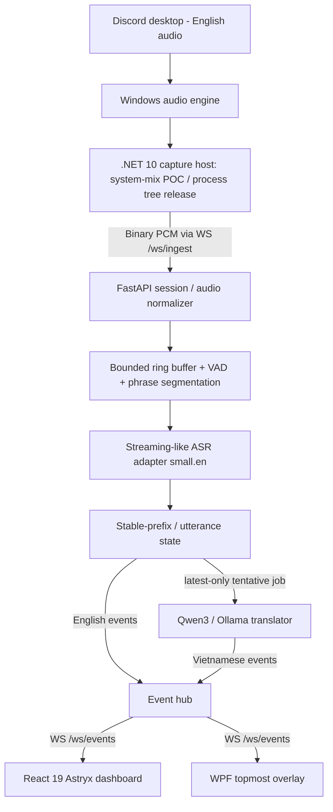

# LocalLingua — COMPLETE PRODUCT / DESIGN / AI / REALTIME BUILD HANDBOOK v2.0

> This single Markdown covers the complete specification. To get source code, tests, agent skills and prompts, use the ZIP kit.


---

<!-- SOURCE: README.md -->

# LocalLingua — Windows 11 English → Vietnamese Live Subtitle Translator

**SPEC v2.0 | 12/11/2026 | Local-first, single-user, engineering handoff for Codex/Claude**

> This is a build kit containing product/technical/design documents, agent skills and an implementation scaffold. It is **not** a finished, benchmarked app, installer, or trained AI model. Individual model runtimes, the application-specific Discord capture backend and real-time performance must be verified on the target PC.

## Goal
While the owner listens to **English speech from Discord desktop on Windows 11**, display **Vietnamese subtitles** with as little delay as possible. Do not require a Discord bot, server administrator permissions, paid cloud API, or an internet connection after local installation/model download.

Personal target machine: Windows 11, **32 GB RAM, NVIDIA GPU with 12 GB VRAM** (exact GPU and driver to verify); no company infrastructure.

## User experience
1. Launch LocalLingua and the AI service. Open Discord, join a voice channel.
2. Select source `System loopback (diagnostic)` until process-specific capture passes acceptance; final selector `Discord process tree`.
3. Click Start. English tentative text and partial Vietnamese text appear, then settle into completed sentences.
4. Choose one or more views: **Astryx web dashboard** (`localhost:5173` during development), **standalone WPF overlay** (always-on-top), optional future desktop WebView2 wrapper.
5. Stop, inspect health/latency, optionally export text. Audio/transcript are NOT saved by default.

## Read in order
- [BUILD_VERIFICATION.md](BUILD_VERIFICATION.md) — honest list of tests performed vs unverified
- [docs/00-DECISIONS.md](docs/00-DECISIONS.md) — locked decisions and non-goals
- [docs/01-PRD.md](docs/01-PRD.md) — detailed product scope and UX
- [docs/02-STACK-AND-MODELS.md](docs/02-STACK-AND-MODELS.md) — all versions, Hugging Face URLs, download instructions
- [docs/03-ARCHITECTURE.md](docs/03-ARCHITECTURE.md) — components, event contract and dataflow
- [docs/04-REALTIME-ENGINE.md](docs/04-REALTIME-ENGINE.md) — scheduling, VAD, stability, translation, backpressure
- [docs/05-DESIGN-ASTRYX.md](docs/05-DESIGN-ASTRYX.md) — design language, component and accessibility rules
- [docs/06-WINDOWS-CAPTURE.md](docs/06-WINDOWS-CAPTURE.md) — real OS constraints, Discord isolation milestones
- [docs/07-SECURITY-PRIVACY.md](docs/07-SECURITY-PRIVACY.md)
- [docs/08-TESTING-BENCHMARK.md](docs/08-TESTING-BENCHMARK.md)
- [docs/09-IMPLEMENTATION-PLAN.md](docs/09-IMPLEMENTATION-PLAN.md)
- [docs/10-OPERATIONS.md](docs/10-OPERATIONS.md)
- [docs/11-CONTRACTS.md](docs/11-CONTRACTS.md)
- [docs/12-TROUBLESHOOTING.md](docs/12-TROUBLESHOOTING.md)
- [docs/13-REFERENCES.md](docs/13-REFERENCES.md)
- [docs/14-AGENT-TASKS.md](docs/14-AGENT-TASKS.md)

## Agent instructions
Read [AGENTS.md](AGENTS.md) and [CLAUDE.md](CLAUDE.md) first. Reusable procedural skills live under `.agents/skills/`; there are task prompts under `prompts/`. Every milestone is independently testable.

## Scaffold contents / honesty ledger
| Area | Included | Status |
|---|---|---|
| Python FastAPI service | HTTP health/status/control, UI WebSocket, ingest WebSocket, demo event emitter | **scaffold code** |
| ASR and translation | faster-whisper adapter, Ollama adapter, mock adapter | **code to test locally** |
| Audio | Windows system output loopback host, sends PCM | **diagnostic only**, not Discord-specific |
| WPF overlay | topmost, draggable, Vietnamese text + connection state | **starter** |
| Web UI | React 19 + Astryx neutral theme + live caption dashboard | **starter**; install dependencies |
| Discord-only process capture | Architecture, Microsoft sample link, acceptance gates | **not yet implemented** — must do M2 |
| Nemotron streaming ASR | Model link, research decision gate | **not integrated** |
| 30-min latency performance | Measurement plan and targets | **not measured** |

## Quick start: Windows PowerShell (development)
Install: .NET 10 SDK, Python 3.11, Node 22 LTS-compatible version, Git, NVIDIA driver; Ollama and model later.

```powershell
# 1) Python engine
cd services/engine
py -3.11 -m venv .venv
.\.venv\Scripts\Activate.ps1
pip install -r requirements.txt
Copy-Item .env.example .env
python -m uvicorn app.main:app --host 127.0.0.1 --port 8765

# 2) React dashboard (new terminal)
cd apps/web
npm install
npm run dev
# Open http://127.0.0.1:5173 — click Demo (does not need AI)

# 3) Native system-loopback PoC (new terminal): captures ALL device output,
#    not just Discord; do not use in confidential meetings before isolation test.
cd apps/windows/LocalLingua.AudioHost
dotnet restore
dotnet run

# 4) WPF overlay (optional fourth terminal)
cd apps/windows/LocalLingua.Overlay
dotnet run
```

For *actual* ASR, run `pip install faster-whisper` in the backend venv and set `ASR_BACKEND=whisper` in `services/engine/.env` and install the CUDA/cuDNN requirements compatible with CTranslate2. For *actual* translation, install Ollama, pull a Qwen 4B local model and set `TRANSLATE_BACKEND=ollama`. **Both start in safe mock/demo mode.** Follow the detailed setup/diagnostics before entering a live meeting.

## Immutable product principles
- A graceful 2–5 second meaning-preserving translation is better than speculative 300ms hallucination.
- Partial captions may change; finalized captions must not be silently rewritten.
- If translation falls behind, drop stale **partial** jobs, never silently drop finalized speech.
- Local mode means no external inference calls, telemetry, CDNs or cloud transcript storage at runtime.
- No model, latency or VRAM claim without an actual measured run.


---

<!-- SOURCE: BUILD_VERIFICATION.md -->

# LocalLingua kit — validation record (2026-11-12)

## Successfully verified in this environment
- ZIP file generation and file-structure JSON schema validation.
- Python code AST syntax check.
- Python API, audio formatting, stable prefix, revision gate, translation-result sanitization and demo WebSocket tests: **10 passed** with `python -m pytest -q`.
- Package and Astryx versions cross-checked with official web documentation; Astryx `0.7.12` pinned consistently to match its published release group.

## NOT verified here (must be done on target Windows 11 machine)
- `dotnet build` / .NET 10 WPF overlay: runtime SDK unavailable in build container.
- `npm install` / `npm run build`: registry DNS inaccessible from build container (`EAI_AGAIN`), therefore React TypeScript compile not proven.
- NAudio and application-specific Windows loopback: cannot test Windows WASAPI from Linux container.
- Real GPU faster-whisper or Qwen/TranslateGemma inference: no target GPU/model weights provided.
- Latency, 30-minute soak test, memory, ASR quality and translation quality: **not measured**.
- True Discord-only process capture: **not yet coded**, explicitly mandatory milestone M2.
- Release-grade security (session token, Origin restriction) and offline packaged installer: not implemented.

## Honest scope
This ZIP is a high-detail design/agent instruction bundle **plus a starter codebase**. It is not a completed fully tested desktop product. Run milestones in order; do not bypass M2/M3 gates or claim realtime SLO without measured data.


---

<!-- SOURCE: AGENTS.md -->

# LocalLingua — coding-agent operating contract

You are building a **personal, local-first Windows 11 English→Vietnamese live subtitle companion**. You MUST follow the design and gates in README and docs. Do not invent APIs, model versions, current performance or missing code. Keep build/test evidence.

## Before any code
1. Read `docs/00-DECISIONS.md`, `docs/09-IMPLEMENTATION-PLAN.md`, `docs/04-REALTIME-ENGINE.md`.
2. Read the task-specific skill under `.agents/skills/`.
3. Check environment (`dotnet --info`, `python --version`, `nvidia-smi`, `node --version`, `npm --version`); report absent dependencies. Do not silently downgrade target frameworks.
4. Check Astryx component APIs with `npx @astryxdesign/cli init` and `npx @astryxdesign/cli component <Component>` **after npm install**. Avoid guessing prop names.

## Absolute rules
- Target `net10.0-windows` for .NET projects. No .NET 8/9.
- Source speech is ENGLISH; target captions VIETNAMESE. Don't build two-way interpretation or bot participation.
- Use official Astryx packages (`@astryxdesign/core`, `@astryxdesign/theme-neutral`, `@stylexjs/stylex`), not a made-up Astryx clone. Do not copy images/fonts from the website.
- No external model calls without explicit user opt-in; default loopback network binding `127.0.0.1` only.
- Keep `ASR_BACKEND=mock`, `TRANSLATE_BACKEND=mock` for fast tests; demonstrate real providers only after dependencies verified.
- Start with system loopback to prove audio path; `Discord-only capture` is a separate P0 gate. Do NOT claim whole-system loopback == Discord-isolated capture.
- Do not claim stable realtime from rolling-window Whisper without benchmark. Mark tentative/final semantics.
- Never fabricate an achieved test or publish screenshots as if native functionality were verified.
- No admin Discord token, selfbot, account credential scraping or stealth background recording.
- No audio logging or retention by default; transcript opt-in only.

## Branch / delivery discipline
- Complete one milestone with working test then move on. Each PR: exact files, test invocation and result, risks/open items.
- Add regression tests for audio silence, repeated ASR words, canceled stale translations, reconnect, out-of-order revisions.
- Any UI change must preserve keyboard access, contrast and visual hierarchy.
- Prioritize bounded memory and measurable P50/P95 rather than feature count.
- Keep UI labels human-readable Vietnamese. Use English IDs/code comments where appropriate.

## Definition of done for each milestone
See `docs/08-TESTING-BENCHMARK.md` and `docs/09-IMPLEMENTATION-PLAN.md`. Any unmet gates must be disclosed as TODO, not hidden.


---

<!-- SOURCE: docs/00-DECISIONS.md -->

# ADR / Architecture decisions

| ID | Status | Decision | Why / trade-off |
|---|---|---|---|
| ADR-001 | Accepted | Windows 11, one user, English → Vietnamese ONLY | Limits latency, cost, surface area |
| ADR-002 | Accepted | Local by default: no cloud inference/telemetry | Personal privacy |
| ADR-003 | Accepted | Native .NET **10 LTS** audio integration and WPF overlay | Windows audio capture + transparent topmost window |
| ADR-004 | Accepted | React 19 + official **Astryx** for dashboard | Agent-ready component library, theming; not an imitation |
| ADR-005 | Accepted | Python 3.11 + FastAPI + WebSocket engine | Speech/translation ecosystem |
| ADR-006 | Accepted | System loopback *diagnostic* first, Discord process-tree loopback *required before v1* | Different capability; avoid false claim |
| ADR-007 | Accepted | Faster-whisper small.en baseline; Nemotron as benchmark challenger | Reliable baseline before streaming optimization |
| ADR-008 | Accepted | Qwen3 4B GGUF quantized local translation baseline, TranslateGemma challenger | Fast practical Windows path; benchmark choice |
| ADR-009 | Accepted | Two-tier captions: tentative revisions + immutable finalized utterance | Balances latency and stability |
| ADR-010 | Accepted | In-memory by default; export with explicit action | Do not build database before realtime proof |
| ADR-011 | Accepted | Streaming UI over localhost; web itself does NOT listen to desktop Discord | Browser permission model limitation |
| ADR-012 | Accepted | Latency-first test gate, 30-minute steady-state test | Backlogs doom live translation |
| ADR-013 | Accepted | No embeddings/RAG/vector DB/agent orchestration in v1 | Unnecessary complexity |
| ADR-014 | Accepted | No user identification from mixed Discord audio | Speaker diarization not reliable by default |

## Not decided: require measurement
- Which GPU model/driver? User only confirmed 12 GB VRAM. Verify.
- Is direct Windows Nemotron streaming practical? Benchmark after baseline works.
- Is translation via Qwen faster or more meaningful than TranslateGemma for Discord/Web3 language? Collect test corpus.
- Does actual process capture work across Discord updates, GPU devices and restarts? Test process tree/detachment.
- Can p95 partial translation be ≤2s while preserving meaning? Treat as target, not a promise.

## Release phases
- v0: demo UI/backend/mock no capture.
- v0.1: native system output capture + real ASR/translator (diagnostic).
- v0.2: Discord-isolated capture proven + reconnect.
- v0.3: stability, metrics, 30-min test + overlay.
- v1.0: packaged local personal app, privacy and error handling polished.


---

<!-- SOURCE: docs/01-PRD.md -->

# Product Requirements — detailed

## Problem statement
The user joins English-speaking Discord Voice Channels/Stages (including Web3 communities), cannot understand fast native conversations, and needs readable Vietnamese meaning quickly without asking other participants to change behavior. The product should not create meeting rooms or impersonate a Discord bot.

## Primary persona
One Vietnamese Windows 11 desktop user (32 GB system RAM, 12 GB NVIDIA VRAM), developer/security background. Fluent understanding not assumed. Works with Discord desktop, headset; may simultaneously use Chrome and a secondary monitor.

## Jobs to be done
1. Hear the remote English speaker normally without a delayed audio loop.
2. Read concise Vietnamese translation near realtime, including crypto/Web3 technical vocabulary.
3. Recognize whether a caption is preliminary or final; not lose already-confirmed information.
4. Move a transparent caption overlay over any desktop window, or read a dedicated pop-out/window/browser.
5. Diagnose slow GPU/model processing and change profile without programming.
6. Optionally review/export text **only when explicitly enabled**.

## Functional requirements
| ID | Priority | Requirement | Acceptance |
|---|---|---|---|
| F01 | P0 | Listen to system output on Win11 for PoC | Audible external English yields PCM frames and original playback unchanged |
| F02 | P0 release | Isolate Discord process tree | Non-Discord YouTube audio NEVER enters captured stream in test |
| F03 | P0 | English ASR near-real-time | Emits partial/final events with proper segment ID, order and timestamps |
| F04 | P0 | English→Vietnamese translation | Meaning/negation/amounts/terms not systematically corrupted |
| F05 | P0 | Realtime bounded queues | 30 min test does not accrue infinite lag; stale partial jobs dropped |
| F06 | P0 | Captions window | Always on top, drag, resize (later), selectable size, contrast |
| F07 | P0 | Web dashboard | Current sentence, history, source selection/status, performance |
| F08 | P0 | Offline after models installed | Network disconnected still captions, no calls to external APIs |
| F09 | P0 | Start/Pause/Stop controls | State machine enforced, no hidden capture while stopped |
| F10 | P0 | Privacy | Explicit signal when recording/capture active, no automatic disk storage |
| F11 | P1 | Custom glossary | User-controlled term mapping for Web3/crypto acronyms and entities |
| F12 | P1 | Export | TXT/MD/SRT optional, local path selected by user |
| F13 | P1 | Adaptive performance profile | Fast/Balanced/Quality with measured settings |
| F14 | P1 | Process/device reconnect | Handles Discord quit/reopen, headset switch, engine restart |
| F15 | P2 | Speaker labels | Best effort only; never infer speaker identity falsely |

## Nonfunctional requirements
- P95 backend frame ingest under 100ms on unloaded system; capture must not block translation.
- P50 **first meaningful Vietnamese partial** target ≤2 seconds after relevant speech begins; P95 of finalized caption target ≤5 seconds after end-of-utterance. These targets are experimental and may need adjustment.
- 30-minute English test: no rising end-to-end lag or unbounded memory; FPS and average acoustic delays recorded.
- Single-machine, no background server exposed beyond `127.0.0.1`; one active capture producer, multiple local UI subscribers.
- Accessibility: WCAG-style readable contrast, keyboard interactions, screen-reader labels in dashboard. No forced unreadable animation.
- CPU/GPU compute does not interfere with Discord playback or push the host into sustained VRAM OOM.

## Out-of-scope v1
- Discord OAuth/selfbot/API chat scraping, recording people covertly, server administrator requirements.
- Vietnamese speech output / AI voice dubbing (causes lag and sound collision).
- Auto language detection / bidirectional speech translation; support dozens of simultaneous speakers.
- Meeting bot, hosted SaaS, payments, user accounts, synchronization, Kubernetes, RAG/vector DB.

## Journey / user flows
**First-run:** install → download model(s) with license info → hardware/driver diagnostic → loopback test → select Discord → display styles → calibrate speech-to-caption delay → enter meeting.

**Normal:** open LocalLingua → check ASR/translation/Discord indicators → Start → partial (dim) → final (high contrast) → Pause or Stop → explicit Export if needed.

**Failure:** capture not detected → helper describes PID/endpoint/audio mixer; ASR unavailable → show English text status; translator unavailable → show English text and error instead of bogus Vietnamese.

**Negative scenarios:** disconnections, 30s silence, 2 voices overlapping, speaker interrupts, rapidly switching device, extremely quiet speech, sudden music, fake command spoken by participants, malicious website tab.


---

<!-- SOURCE: docs/02-STACK-AND-MODELS.md -->

# Full stack / model sources and downloads

Verified 12 Nov 2026. **Do not confuse a Hugging Face model page with a compatible runtime/quantized artifact**. Follow the model card and license. Models are NOT included in this ZIP (gigabytes and licensing).

## Application
| Layer | Version/option | Purpose |
|---|---|---|
| OS | Windows 11 x64 | App-specific WASAPI capture |
| Capture host | C# .NET 10 LTS + NAudio for system mix POC | Audio source normalization / native integration |
| Release process capture | Microsoft Windows Application Loopback sample (C++/COM) or verified C# wrapper | Exclude other applications |
| Overlay | C# .NET 10 WPF | Topmost click-through-capable translucent captions |
| Web | React 19, TypeScript, Vite | UI dev, locally served dashboard |
| Design system | `@astryxdesign/core`, `@astryxdesign/theme-neutral`, `@stylexjs/stylex`, `@astryxdesign/cli` | Official Meta Astryx (MIT) |
| AI API | Python 3.11, FastAPI, uvicorn, WebSocket | Local control & stream protocol |
| ASR | faster-whisper / CTranslate2 | EN streaming-like rolling baseline |
| Audio gating | Silero VAD optional, prototype simple RMS energy gate only | Avoid inference during silence |
| Translation | Qwen3 4B GGUF Q4_K_M via Ollama or llama.cpp local | EN→VI text generation |
| Packaging | .NET publish + local Python build, future installer | User PC only |
| Database | No DB v1, optional SQLite for opted-in history | Privacy and simplicity |

## 1. Hugging Face official links
| Role | Model / URL | License visible on model page | Notes |
|---|---|---|---|
| ASR baseline | https://huggingface.co/Systran/faster-whisper-small.en | MIT | Optimized CTranslate2 small.en checkpoint |
| ASR challenger | https://huggingface.co/nvidia/nemotron-speech-streaming-en-0.6b | NVIDIA Open Model License | Real cache-aware streaming; Windows integration gate |
| Translator baseline (official quantization) | https://huggingface.co/Qwen/Qwen3-4B-GGUF | Apache 2.0 | Official GGUF Q4_K_M usable with llama.cpp/Ollama |
| Translator original | https://huggingface.co/Qwen/Qwen3-4B | Apache 2.0 | Unquantized model: not the same as GPU Q4 runtime |
| Translation challenger | https://huggingface.co/google/translategemma-4b-it | Gemma license | Needs supported Transformers runtime; not interchangeable GGUF |
| Research-only small translation | https://huggingface.co/facebook/nllb-200-distilled-600M | CC BY-NC 4.0 | **Noncommercial / research use**; not default for redistributable commercial app |

## 2. Download commands

```powershell
# Base: https://huggingface.co/docs/huggingface_hub/en/guides/cli
py -3.11 -m pip install -U huggingface_hub
# Optional: inspect cache or materialize model to a local folder
hf download Systran/faster-whisper-small.en --local-dir "$env:USERPROFILE\Models\faster-whisper-small.en"

# Ollama easiest route for official Qwen GGUF from Hugging Face:
# Install Ollama from https://ollama.com/download/windows, then:
ollama run hf.co/Qwen/Qwen3-4B-GGUF:Q4_K_M
# NOTE: verify actual installed model ID using `ollama list` and copy it into OLLAMA_MODEL.

# Or with llama.cpp installed from WinGet:
winget install llama.cpp
llama serve -hf Qwen/Qwen3-4B-GGUF:Q4_K_M
# Exact binary CLI name/flags should be verified on installed llama.cpp version.

# Research-only downloads (do not download until needed)
hf download google/translategemma-4b-it --local-dir "$env:USERPROFILE\Models\translategemma-4b-it"
hf download nvidia/nemotron-speech-streaming-en-0.6b --local-dir "$env:USERPROFILE\Models\nemotron-speech-streaming"
```

For the real ASR backend, first install `pip install faster-whisper` inside the engine venv and verify the official CUDA/cuDNN prerequisites. For Whisper, `WhisperModel('small.en', device='cuda', compute_type='int8_float16')` automatically fetches the supported checkpoint to the model cache on first run. Use the `model path` if working offline. The Python code defaults to CPU/mock until explicitly changed; **CUDA 12 + cuDNN 9 requirements for current CTranslate2 must be satisfied and benchmarked**; see https://github.com/SYSTRAN/faster-whisper.

## 3. Why Qwen baseline first, TranslateGemma challenger later
- Official Qwen3 GGUF has documented Windows llama.cpp/Ollama path, Q4_K_M available, suitable for a 12GB VRAM experiment.
- Qwen may generate verbose explanations; prompt must demand translation only, `temperature=0`, token cap, /no_think where supported; strip hidden reasoning rather than display it.
- TranslateGemma 4B is translation-focused, but its official base checkpoint is Gemma-family multimodal Transformers, **not** a drop-in `ollama run translategemma:4b` guarantee; must validate runtime, format and license before adopting.
- Model choice requires *actual* benchmarks on short informal Discord conversations (acronyms, negation, fast speech, slang).

## 4. VRAM planning — indicative ONLY
For one NVIDIA 12 GB GPU, a quantized 4B model and a small ASR model *may* coexist, but CUDA buffers, KV cache, fragmentation and desktop apps consume additional space. Verify actual maximum allocated GPU memory with `nvidia-smi` while running both. If OOM, reduce Qwen context, use smaller ASR, reduce model residency, or move one component to CPU. Do not assume 12GB VRAM is fully free.

## 5. ASR choice gate
Compare rolling small.en with genuine streaming Nemotron **only after** basic bridge and UI work. Compare WER, stability, latency, VRAM, model compatibility, setup complexity and continuous-running behavior. Native 80ms audio chunks are NOT an 80ms translated subtitle guarantee.

## 6. Reference tooling
- Microsoft app loopback sample: https://github.com/microsoft/Windows-classic-samples/tree/main/Samples/ApplicationLoopback
- Astryx docs: https://astryx.atmeta.com/docs/getting-started
- Astryx CLI/docs source: https://github.com/meta/astryx
- faster-whisper: https://github.com/SYSTRAN/faster-whisper
- Silero VAD: https://github.com/snakers4/silero-vad
- NeMo Speech C++: https://github.com/NVIDIA/NeMo-Speech.cpp
- Hugging Face CLI: https://huggingface.co/docs/huggingface_hub/en/guides/cli
- .NET lifecycle: https://dotnet.microsoft.com/en-us/platform/support/policy


---

<!-- SOURCE: docs/03-ARCHITECTURE.md -->

# Runtime architecture / boundaries



## Explicit process boundaries
- `AudioHost.exe` owns Windows capture; no ML libraries. It sends `audio.format` JSON once and binary PCM frames; audio capture thread never waits on AI.
- `FastAPI` owns inference state, utterance lifecycle, bounded queues, backend selection, metrics and local event hub.
- `apps/web` owns theme, layout, user controls, latency graphs/history. It is NOT authorized to capture Discord application audio directly.
- `Overlay.exe` reads event stream, displays last Vietnamese caption; it MUST NOT independently load ML models.

## Network/control plane
- Backend: `127.0.0.1:8765` (`/health`, `/api/status`, `/api/control`, `/ws/ingest`, `/ws/events`).
- Web UI dev: `127.0.0.1:5173`; production build served through a local host in later milestone.
- Ollama: `127.0.0.1:11434`, used only when explicitly enabled; no off-machine access.
- A single ingest session at a time; concurrent UIs may subscribe. Reject or replace producer based on visible policy (M2) to avoid audio duplication.

## Sequence
1. UI connects and fetches status. `capture=inactive` until host is actually connected.
2. Audio host connects to `/ws/ingest`, sends format `{sample_rate,channels,sample_format}` and binary frames. Current PoC is **system loopback**, not Discord-only.
3. Backend validates format, normalizes PCM to float32 mono 16 kHz (streaming resampler refinement required), enqueues into bounded recent-audio window. No persistent audio writes.
4. VAD partitions active audio; ASR sees rolling crops with overlap. ASR emits tentative text, later final utterance.
5. Translation consumes stable clauses / final utterance with revision IDs; superseded tentative job results must not overwrite newer text.
6. Event bus fans out to web and WPF, clients discard out-of-order revisions.
7. Metrics record capture, ASR, translation timings and event age; transcript export only with explicit user action.

## Typed event wire format (v1)
See `contracts/events.schema.json` and `docs/11-CONTRACTS.md`. All times are monotonic for latency analytics when possible; `created_at_ms` is wall clock UTC for display only. Do NOT subtract monotonic clocks across processes unless an offset calibration exists. On one process, use `perf_counter` for ASR queue waits; for end-to-end latency use audio sample index + anchor correlation and carefully defined uncertainty.

## Known anti-patterns
- Calling Whisper in the WASAPI DataAvailable callback.
- Capturing system output and claiming it is Discord-only.
- Feeding one ASR inference result for each 20ms chunk; rolling windows cause duplication.
- Translating every token, causing unstable Vietnamese sentence order.
- Infinite asyncio queue, unbounded latest-results list, GPU model loaded twice.
- Catch-all exception that silently replaces failed model with a fake translation.
- Storing every audio byte as a debugging convenience.

## Planned source-specific capture design
Microsoft process-specific loopback uses `ActivateAudioInterfaceAsync` with `AUDIOCLIENT_ACTIVATION_TYPE_PROCESS_LOOPBACK` and `AUDIOCLIENT_PROCESS_LOOPBACK_PARAMS` and `TargetProcessId`, modes `PROCESS_LOOPBACK_MODE_INCLUDE_TARGET_PROCESS_TREE`. Use official C++ sample to validate PID tree before porting to .NET. When Discord changes PID, the capture host must re-enumerate/reinitialize. `WasapiLoopbackCapture` in NAudio is a whole-output-endpoint capture, not equivalent.


---

<!-- SOURCE: docs/04-REALTIME-ENGINE.md -->

# Realtime audio / ASR / translation — engineering algorithm

## Definitions
- `Audio frame`: 20–60ms PCM from Windows loopback, not a sentence.
- `Rolling ASR window`: ~2.4–4.0 seconds sampled from recent ring buffer, refreshed ~600–900ms in baseline.
- `Utterance`: contiguous audible speech separated by silence (or max-duration segmentation). One unique `utterance_id`.
- `Tentative/partial`: text may be revised with increasing `revision`.
- `Final`: stable text for a finished utterance; never modified without an explicit correction event.
- `caption age`: time since speech segment endpoint, not time since model call.

## Why streaming translation is hard
English negation/completion may come late. Literal 1-word translations oscillate and cause meaning errors. Use **semantic clause batching**: ASR previews quickly, translate only stable clauses after punctuation, stable word boundary, or 0.9–1.5s confirmation; force final translation on speech end with bounded wait. Maintain previous 1–3 *final English* turns as context, never treat raw speaker output as instructions.

## Prototype scheduler, with tunables (NOT claimed measured)
```yaml
capture:
  frame_ms: 40
  sample_rate_native: 48000
  resample_to_hz: 16000
  max_pcm_backlog_ms: 800
vad:
  prototype: rms_energy_threshold  # replace with Silero VAD + hysteresis
  speech_onset_ms: 120
  silence_end_ms: 650
  min_utterance_ms: 350
  max_utterance_ms: 11000
asr:
  rolling_window_ms: 3600
  interval_ms: 850
  overlap_ms: 500
  beam_size: 1
  language: en
translation:
  tentative_min_interval_ms: 1300
  max_input_words: 55
  max_output_tokens: 110
  context_final_utterances: 2
  max_queue_tentative: 1
```

## Robust partial stabilization — to implement/benchmark
1. Collect successive ASR hypotheses for SAME utterance (H_n, H_n+1).
2. Normalize whitespace/casing **for comparison only**, preserve original display text.
3. Find stable common WORD prefix (with punctuation heuristics). Require 2 successive observations for commit.
4. Emit `transcript.partial` when changed (revision++) without committing an unstable suffix.
5. Translate only a stable semantic clause or after a max wait and label result tentative.
6. On silence >650ms, run final ASR on the bounded utterance crop, emit `transcript.final`, then `translation.final` when ready.
7. If a new utterance begins while final translation is still busy, prioritize latest caption while preserving committed ordering in history.
8. Never turn absence of speech into hallucinated captions; gate on energy/VAD and avoid language detection for other languages in v1.

## Queue discipline
**Capture queue** (bytes): bounded by ~0.8s; on overload drop oldest raw frames and increment `audio_dropped_frames`; do not block capture callback.
**ASR work**: at most one model inference at a time; stale rolling candidates superseded; final utterance jobs can be prioritized over stale partials.
**Translation tentative**: latest-wins per utterance; keep `revision`, generation ID, `deadline`; ignore output from older revisions.
**Translation final**: bounded FIFO with explicit visible overflow error, never silently pretend all speech has been translated.
**UI subscriber**: per-connection bounded send queue; on slow UI drop partials first and send status about backlog; finalized messages not silently erased from history.

## Revision protocol
```json
{
  "type": "translation.partial",
  "utterance_id": "abc-0001",
  "revision": 4,
  "is_final": false,
  "english": "We will launch but not yet",
  "vietnamese": "Chúng tôi sẽ ra mắt, nhưng chưa phải lúc này.",
  "created_at_ms": 1794470000000
}
```
If UI already saw revision 5, it MUST ignore revision 4. Final is immutable. Do NOT display raw `<think>` tags or assistant preambles from LLM.

## Segmenting utterances under uninterrupted speech
Set forced flush every ~7–11s or at stable punctuation/clause boundary. Back-to-back merged segments must have unique IDs, contiguous timestamps, and ≤0.5s context overlap for ASR. Align overlapping words by timestamp where available, else use token-level LCS de-dup. Long unbroken talk cannot be held until speaker fully stops.

## Timestamp plan and latency budget
Track: `capture_sample_start/end`, `ingest_t`, `vad_onset_t`, `asr_request_t`, `asr_result_t`, `translate_request_t`, `translate_result_t`, `ui_render_t`. `perf_counter()` is safe for intervals in the same process. Cross-process capture→render latency needs explicit synchronization or audio reference test fixture.

SLO experiments:
- P50 first intelligible *Vietnamese partial* ≤2s relative to speech material needed to translate.
- P95 final Vietnamese caption ≤5s after utterance end, on 30-min one-person normal-load test.
- P99 capture queue <0.8s; no growing lag trend; VRAM stable and no inference memory leak.
- Track separate trade-off: word error rate (WER), translated meaning correctness, entity/number/negation accuracy.

These are TARGETS, not present system capabilities.

## Negative cases
- Discord audio stops for 30s: do not emit silence hallucinations.
- Interrupted speaker changes direction: revise tentative translation, final must reflect negation.
- Audio overlap: show an ambiguous caption, do not assert speaker name.
- Vietnamese voice from another program: process-only capture MUST exclude it, don't auto-translate 50 languages.
- ASR GPU OOM: explicit failed state + optional CPU fallback with warning; no hidden infinite retry.
- 6 hours in background: idle VAD should preserve resources; audio capture can be paused.
- Model outputs a malicious command: treat it as QUOTED AUDIO CONTENT, not a system instruction.

## Production improvements beyond scaffold
The starter engine demonstrates the protocol and a rolling ASR path, but lacks validated production VAD/hysteresis, sample-accurate streaming resampling, hard deadlines, real latency sync and process isolation. Treat these as milestone deliverables rather than done.


---

<!-- SOURCE: docs/05-DESIGN-ASTRYX.md -->

# UI/UX design system — Astryx by Meta, not a clone

## Sources and use
Site: https://astryx.atmeta.com/ — Docs https://astryx.atmeta.com/docs/getting-started — Repo https://github.com/meta/astryx (MIT). Astryx is **a React component/design system** currently in beta. The user likes its modern, spacious, understated interface; use official packages for foundation and customize visual identity. Do NOT copy Meta assets, page imagery or logos; do NOT invent an '@astryx' library.

## Product personality
- Name: **LocalLingua**; working title only (check trademark if published).
- Focus: purposeful, calm, responsive, low-distraction tool. Audio and subtitle are primary, AI decorations are secondary.
- Default: subtle dark graphite theme for nighttime Discord, optional light theme.
- Palette suggestion (application-level, independent of Astryx token names):
  - Background `#0F1117`, panel `#191D27`, elevated `#222736`, border `#353C4B`.
  - Text primary `#F1F4FA`, muted `#A8B1C3`, quiet `#7E899B`.
  - Accent cool periwinkle `#8B9BFF`, success `#58C69A`, warning `#E6B873`, error `#ED7C81`.
- Typography: use Astryx neutral typography and configured font stack; no bundling copyrighted/unlicensed fonts. 13–15px UI; captions 20–30px adjustable.
- Spacing: 4/8/12/16/24/32; radii 10–14px for sections; clean lines and 1px borders.
- Avoid gaudy gradients and huge cards, use one highlight to direct attention to current translation.
- Respect reduced motion; no flashing audio waves for decorative effect.

## Information architecture
**Screen A — Live Console**
- Left sidebar width ~224px: Live, History (optional), Glossary (P1), Benchmark, Settings.
- Top bar: LocalLingua, current source `Discord`/`System Diagnostic`, ASR model, local/online label, status LED.
- Center 65–72%: current Vietnamese subtitle prominent; English original directly underneath in a subtle color; 6–10 latest lines below.
- Right inspector width ~260px on wide screens: current pipeline status, audio RMS, ASR and translation p50/p95, dropped frames, GPU memory.
- Bottom transport: Start/Pause/Stop, translation preset, capture source, last failure. No misleading active toggle if host isn't connected.

**Screen B — Compact caption panel**
- Width ~350–620px; large Vietnamese translation 2–3 lines and small English original (optional).
- Status dot small; drag handle, pin/topmost icon, size control, opacity control. Avoid obscuring entire Discord call.

**Screen C — Settings**
- Input source (system diagnostic vs Discord isolated), audio output device, language fixed EN→VI, model backend status, quality mode, glossary, privacy and export preferences.
- Disabled source selector explains gating: `Discord-only capture chưa hoàn thành/không khả dụng` rather than pretending success.

**Screen D — Diagnostics**
- Audio level and sample rate, model loaded, queue length, median/p95 timings, VRAM. Actions: play test wav, test translation, compare profiles. All run locally.

## States to design deliberately
`Not started`, `Starting`, `Listening`, `Speech detected`, `Transcribing`, `Translating`, `Degraded: backlog`, `Paused`, `Stopped`, `Error: no audio`, `Error: model unavailable`, `Error: Discord source lost`.

## Caption semantics and visual hierarchy
- Tentative EN in muted grey (never pretend finalized).
- Tentative VI with soft accent label **Đang dịch...** and visible subtle revision status.
- Final VI high contrast; final EN secondary; timestamp accessible.
- On translator failure show EN and explicit issue (never show a fake Vietnamese caption).
- Long sentences wrap; max 3 lines visible, full transcript scroll in dashboard; no auto-scroll if user reading history.

## Astryx official installation (developer executes)
```powershell
cd apps/web
npm install
npx @astryxdesign/cli init
npx @astryxdesign/cli component Button
npx @astryxdesign/cli component Card
npx @astryxdesign/cli theme list
```
The scaffold uses `@astryxdesign/core/Button`, `@astryxdesign/core/theme` and `@astryxdesign/theme-neutral/built`, supported by official docs. Keep ordered CSS imports:
```css
@import '@astryxdesign/core/reset.css';
@import '@astryxdesign/core/astryx.css';
@import '@astryxdesign/theme-neutral/theme.css';
```
For a custom theme use official `npx @astryxdesign/cli theme add neutral`, `defineTheme` + build, not shadowing private CSS vars. Product-specific layout may use ordinary CSS, but shared controls must prefer Astryx. Always consult `astryx component <Name>` for props.

## Interaction rules
- Dashboard Ctrl+Enter: start/pause only if user assigned; Escape should close popover not kill capture silently.
- Make all model statuses screenreader readable. Controls have visible labels; keyboard focus high contrast.
- Overlay pointer behavior: default draggable; optional lock/click-through activated explicitly. Hotkey to unlock overlay so it isn't permanently unclickable.
- Ensure WebSocket reconnect gives current state; never make user believe captions are live when disconnected.

## Responsive behavior
- >1200px: sidebar + transcript + inspector.
- 800–1200px: hide inspector behind collapsible panel; current captions retain width.
- <800px: single-column; source selector and start action remain at top; avoid overflow.
- Overlay is independent/native window (WPF), not a browser floating window confined to tab bounds.

## Component checklist
- Astryx Card for structured content, Button for actions, Badge when informative, native/verified Astryx select or accessible HTML select if needed.
- Contrast and motion accessibility checks, dark/light, keyboard-only, 150% DPI scaling, Windows multi-monitor.
- Only ship after screenshot review with owner; design is utility, not a marketing landing page.


---

<!-- SOURCE: docs/06-WINDOWS-CAPTURE.md -->

# Windows 11 audio capture — critical implementation reference

## Source isolation is the first difficult OS task
- **M0/M1**: `NAudio.Wave.WasapiLoopbackCapture` can capture *all audio mixed at one output endpoint* (e.g. Discord + YouTube). This is a useful smoke test ONLY.
- **M2 release gate**: Windows **Application Loopback** activation can target a process tree using `ActivateAudioInterfaceAsync`, `AUDIOCLIENT_ACTIVATION_TYPE_PROCESS_LOOPBACK`, `AUDIOCLIENT_PROCESS_LOOPBACK_PARAMS` and `PROCESS_LOOPBACK_MODE_INCLUDE_TARGET_PROCESS_TREE`.
- Do **not** claim NAudio `WasapiLoopbackCapture` by itself can select a PID. Verify behavior of any 3rd party wrapper before adopting.
- Official sample: https://github.com/microsoft/Windows-classic-samples/tree/main/Samples/ApplicationLoopback; requires Windows 10 build 20348+ and works on supported Windows 11.

## Process tree plan
1. Discover running `Discord.exe` root and audio-related subprocesses, inspect process ancestry. Multi-process Electron apps can restart children; do not arbitrarily choose first PID.
2. Select confirmed root PID, include descendants with Windows process-loopback API. If separation fails, fall back with red **Whole system audio** warning, never silently.
3. Show test signal: play YouTube audio with Discord muted → captured signal should be silent; have somebody speak Discord while YouTube plays → captured should contain Discord only.
4. Switch Discord output device or restart app → re-resolve process tree and reinitialize capture; warn user when audio source lost.
5. Release COM resources and audio clients on stop. Capture thread must not block on WebSocket.

## Audio format contract
- Capture host sends JSON `audio.format` before raw frames:
  `{ "type":"audio.format", "sample_rate":48000, "channels":2, "sample_format":"float32" }`.
- Then sends raw little-endian interleaved PCM bytes, **not WAV file headers**; backend validates format and normalizes.
- Capture original sample clock, sequence & dropped sample counts need strengthening after prototype to obtain reliable lag metrics.
- Resample to 16kHz mono with a **stateful polyphase resampler** in production; one-frame-independent scipy resampling introduces boundary artifacts. Starter uses simple frame resampling for proof only.

## Discord and privacy
No Discord user token, no selfbot. Native output capture does not need bot account or channel permissions. Respect Discord terms and local law; clearly show listening status and seek consent before recording or exporting others' speech. Automatic transcripts in memory are still processed personal data; no silent background recording.

## Failure matrix
| Symptom | Hypothesis | Verify |
|---|---|---|
| No audio while Discord talks | Wrong render device or process | Check Windows mixer output, process tree, RMS counter |
| Music transcribed | Whole-system capture, no source isolation | Separate YouTube vs Discord with A/B test |
| Only own voice transcribed | Capturing microphone instead of render loopback | Ensure output loopback, not input mic |
| Audio stutters | Capture callback performing inference or blocking I/O | Bounded channel, move send to separate async worker |
| Caption latency grows | Unbounded audio/translation queue | Monitor queue depth and audio age |
| Works once then not | Discord process restarted, output device switched | Re-enumerate and reinit client |

## Technical prototyping sequence
- First run the official Microsoft ApplicationLoopback sample independently writing WAV to prove process isolation. Do not write a managed interop wrapper while basic COM mode is unverified.
- Then port to managed Windows capture service or ship tested native helper with IPC; keep all audio uncompressed only on localhost and in process memory.
- Add UI source dropdown only after both capture modes pass tests. Add per-PID health diagnostic.


---

<!-- SOURCE: docs/07-SECURITY-PRIVACY.md -->

# Threat model, privacy and permissions

## Security goals
- No third-party content service observes private meeting audio/transcript in local mode.
- No external user can invoke audio controls or read transcript over network.
- Audio frame and translated text are ephemeral unless user explicitly exports.
- Remote speaker audio is untrusted text: translated sentences cannot become LLM tool instructions.

## Rules
1. Bind all network listeners to `127.0.0.1`. Do not enable `0.0.0.0` even in examples. If shipping beyond personal PC, add per-session auth token and strong Origin checking; localhost does not imply all local processes are trusted.
2. Use a random per-run session token for `/ws/ingest`, `/ws/events` and `/api/control` before production release, not in starter scaffold (documented limitation). Only local WPF/web clients get this token via secure bridge.
3. Browser CORS: whitelist `http://127.0.0.1:5173` only in dev. Strict Origin validation for WebSocket in release, do not accept arbitrary public websites controlling it.
4. No login/password, Discord auth token, bot token, screen scraping. Never embed HF user tokens in source.
5. Model files: fetch only official sources; review model licenses and pin revision hashes before release. Check raw `*.safetensors`, GGUF and dynamic remote code policies.
6. Audio retention off. `*.wav`, transcripts, screenshots excluded in `.gitignore`; export to explicit user-selected location only.
7. Do not instrument provider telemetry and web analytics. Avoid remotely loaded fonts in packaged offline mode.
8. Warn user that live translation can be wrong about numbers, financial decisions, terms and negation.
9. Log technical metrics but not speech contents by default; debug transcript logging must be opt-in and sanitized.
10. If adding cloud mode later, separate explicit provider approval and clear warning `Dữ liệu có thể được gửi ra ngoài`.

## Threats and mitigations
| Threat | Mitigation |
|---|---|
| Malicious webpage requests localhost | CORS + Origin enforcement + token + content-type restrictions |
| Another local process connects audio WS | Random auth token/OS ACL + single producer lock |
| Discord speaker says "ignore previous instructions" | Treat transcript as data; translation-only prompt, output validation, no tools/actions |
| Disk forensic transcript leakage | No local persistence by default; secure opt-in export |
| LLM hallucinates trading/buy instructions | Show original English alongside Vietnamese, uncertainty notice |
| Model license mismatch | Model registry with exact source, license, revision |
| Unintended other-app audio | Discord-only process loopback gate before release |

## Safeguard status
This ZIP scaffold only enforces some rules (loopback bind, CORS dev, no auto-disk storage); the session-token, stricter WS origin and real Discord isolation are **mandatory release blockers**.


---

<!-- SOURCE: docs/08-TESTING-BENCHMARK.md -->

# Test, benchmark and quality gates

## Test levels
- **Unit**: stable prefix, revisions, transcriber normalization, translator payload cleanup, audio frame parsing, silence gate, bounded queues, error handling.
- **Integration**: stream 30s PCM English to backend → correct partial/final ordering, translated text and UI display. Use deterministic prerecorded WAV with known timestamps.
- **End-to-end**: real Discord native app → real process capture → real GPU models → WPF overlay + Astryx dashboard.
- **Soak**: 30 min continuous conversation, 30 min silence, 10 reconnects, background/foreground app.

## Audio test corpus
Collect **with permission** 20–30 minutes across: slow/fast American/British accents, background music, overlapping voices, interruptions, acronyms (NFT, DAO, mint, whitelist, token, alpha, seed, mainnet, airdrop, snapshot), crypto numbers, dates, negation, mixed chat. Annotate a short held-out reference EN+VI; do not upload confidential recordings.

## Metrics
| Metric | Definition | Example method |
|---|---|---|
| Word Error Rate | EN ASR edit-distance over human reference words | `jiwer` over annotated segments |
| Meaning adequacy | Human-rated Vietnamese preserving sense | 1–5 scale, blind pairwise Qwen/TranslateGemma |
| Negation/number accuracy | Critical correct/incorrect cases | Tagged golden corpus |
| First EN partial | Relevant audio onset to visible EN | Audio/video capture sync |
| First VI partial | Relevant audio onset to readable translated clause | Annotated test harness |
| VI final age | utterance end to final VI screen | Timestamped injection/visual instrumentation |
| Translation service time | request submission to model completion | `time.perf_counter()` |
| Queue audio age | Last played audio sample to ASR processing input | Source sample ID + calibrated clock |
| UI event delay | server event → render ack | Local timestamps + trace ID |
| VRAM RSS CPU | per-process steady state and peak | `nvidia-smi`, process telemetry |
| Drop/reconnect | loss count, restart recovery | Kill/restart capture and Discord |

## Performance goals (UNVERIFIED)
- P50 VI partial ≤2s; P95 VI final ≤5s after utterance end.
- 30-minute lag trend ≤0.5s increase from first five minutes to last five minutes.
- 0 silent loss of already-finalized captions. No repeated 3+ word overlapping line in final transcript.
- No VRAM OOM on GPU 12GB while Discord and browser open.
- No non-Discord audio included when Discord isolation selected.

## Gate M0 (mock demo)
- Python `pytest` green and app `/health` returns 200.
- UI connects to WS, 'Demo' emits EN+VI without models and shows status.
- `.NET` projects at `net10.0-windows`; GUI renders with Windows DPI settings.

## Gate M1 (system audio diagnostic)
- Captures device output reliably 10 min; no playback distortion.
- WAV fixture test ASR transcribes English; Qwen local returns Vietnamese.
- Full system source conspicuously marked, not shipped as final Discord-only feature.

## Gate M2 (Discord isolation) — hard blocker
- When ONLY YouTube produces sound, captured RMS stays near zero.
- When ONLY Discord speaks, captured RMS increases and speech transcribed.
- When BOTH play, output excludes YouTube (subjective and instrumental listening test).
- Restart Discord and switch audio output, recover within an observed bounded interval; no claims until measured.

## Gate M3 (realtime)
- 30 min active English, measured P50/P95; no steadily growing delay.
- Partial output updates without contradictory duplicated finals; translation queue bounded under overload.
- Visual dashboard shows partial/final distinction and health state.

## Gate M4 (personal release)
- Offline after download, standalone startup scripts/install, crash handling, zero default audio retention, local auth/origin security, exit/unload GPU.
- A user can open Discord and start overlay without developer terminal.

## Automated starter tests
`cd services/engine && python -m pytest -q`. Tests in ZIP are meaningful protocol/core tests, **not** evidence of latency and real capture. An actual benchmark report MUST record GPU model, OS build, SDK, driver, model revisions, profile, duration, raw anonymized times, summary table and screenshots.


---

<!-- SOURCE: docs/09-IMPLEMENTATION-PLAN.md -->

# Milestones, estimates and agent execution plan

> Sequence is dependency-based. No vague promise that a 12GB GPU will meet p95 until measured. Use each gate in `08-TESTING-BENCHMARK.md`.

## M0 — Repo / contracts / UI / fake events (first)
**Deliver:** Python FastAPI server on localhost, WebSocket event fan-out, status, demo translated captions, React Astryx dashboard, WPF overlay shell, protocol schema and tests. **Done when:** one terminal sends fake events; both clients render correctly, no AI download needed. **Suggested effort:** 0.5–1 day for experienced dev, not a delivery guarantee.

## M1 — Windows system loopback & first offline AI
**Deliver:** NAudio WASAPI whole-device capture on Windows (clearly diagnostics), ingest with PCM format handshake, ring buffer, basic VAD, faster-whisper small.en, Qwen translation via Ollama. **Done when:** captured YouTube/Discord audio appears in EN and VI after real inference; model run documented; no audio writes. **Effort unknown until CUDA/CTranslate2 drivers verified**.

## M2 — Capture Discord only (release blocker)
**Deliver:** integrate Windows `AUDIOCLIENT_ACTIVATION_TYPE_PROCESS_LOOPBACK` using Microsoft official sample as reference; process-tree selection, device and process recovery, separate output signal tests. **Done when:** YouTube excluded, Discord included, restart works. Don't mislabel NAudio endpoint capture as app-isolated.

## M3 — Realtime correctness/performance
**Deliver:** real VAD, stable prefix, partial/final translation, bounded queues, stale translation cancellation/result revision protection, history and state diagnostics, latency traces, 30-minute test. **Done when:** 30-minute regression passes and P50/P95 reported as measured values.

## M4 — Polished Astryx + overlay UX
**Deliver:** density/palette, sound level meter, multi-monitor overlay, caption controls, hotkeys, glossary and explicit export. **Done when:** owner can operate from mouse/keyboard without terminals.

## M5 — Personal release packaging
**Deliver:** startup/service supervision, local security token/origin protection, offline assets, documented model licensing, portable installer/build, software update plan, crash recovery. **Done when:** clean Windows 11 install can run offline after models downloaded.

## M6 optional — model upgrade experiment
Compare Nemotron streaming ASR versus faster-whisper, TranslateGemma versus Qwen on fixed corpus. Only promote if meaningful quality/latency gain without fragility.

## First 10 agent tasks
1. Environment audit, check packages, nvidia-smi, .NET 10, Python 3.11.
2. Run `pytest` and explain coverage.
3. Build React web frontend with Astryx CLI docs; demo WS works.
4. Build WPF overlay on actual Windows; make it topmost, draggable.
5. Prove system audio endpoint capture with isolated loopback diagnostic.
6. Normalize PCM/resampling and test 16kHz data.
7. Verify faster-whisper CUDA compatibility and 30s English fixture.
8. Verify Ollama Qwen 4B translation and format/safety tests.
9. Prove Discord-only process capture via Microsoft sample, then integrate.
10. Optimize partial/final segmentation, latency and 30-min soak.

## Agent handoff format
Each task result must contain: current branch/files; commands run; tests (exact output); what is simulated vs real; model/revision; current blockers; next task. No green checkmarks without reproduction.


---

<!-- SOURCE: docs/10-OPERATIONS.md -->

# Windows 11 operator/developer runbook

## Prerequisites
- Windows 11 x64, NVIDIA driver with CUDA compatibility, 12GB VRAM GPU, 32GB RAM.
- .NET 10 SDK: https://dotnet.microsoft.com/en-us/download/dotnet/10.0
- Python 3.11 from python.org, Node 22 or newer compatible LTS, npm, Git.
- Ollama Windows or llama.cpp; install only after mock pipeline works.
- Visual Studio 2026 recommended for native WPF/C++ Windows SDK; developer mode optional.

## Commands
```powershell
# verify versions
winver
dotnet --info
py -3.11 --version
node --version
npm --version
nvidia-smi

# API backend
cd services/engine
py -3.11 -m venv .venv
.\.venv\Scripts\Activate.ps1
python -m pip install -U pip
pip install -r requirements.txt
Copy-Item .env.example .env
python -m uvicorn app.main:app --host 127.0.0.1 --port 8765

# smoke test /health
Invoke-RestMethod http://127.0.0.1:8765/health

# web frontend, another terminal
cd apps/web
npm install
npx @astryxdesign/cli init
npm run dev

# native host, another terminal
cd apps/windows/LocalLingua.AudioHost
dotnet restore
dotnet run

# overlay, another terminal
cd apps/windows/LocalLingua.Overlay
dotnet restore
dotnet run
```

## Real AI provider activation
Edit `services/engine/.env`:
```env
ASR_BACKEND=whisper
WHISPER_MODEL=small.en
WHISPER_DEVICE=cuda
WHISPER_COMPUTE=int8_float16
TRANSLATE_BACKEND=ollama
OLLAMA_URL=http://127.0.0.1:11434
OLLAMA_MODEL=hf.co/Qwen/Qwen3-4B-GGUF:Q4_K_M
```
Model ID must match `ollama list` exactly; changing model may need restart. To isolate problems set `ASR_BACKEND=mock` or `TRANSLATE_BACKEND=mock` separately.

## Runtime check
- Confirm `/api/status` reports capture connected and backend choices. Use `/api/control` `mode=start|pause|stop`; demo is `/api/demo`.
- Test original stream with a permitted prerecorded speech sample before live Discord.
- If no sound check Windows output device/headphones and host console.
- If backend fails to start, check port 8765, package dependencies, .env and Python 3.11.
- If model OOM check `nvidia-smi`, close GPU-heavy applications, reduce model/context; do not silently send audio to cloud.

## Export & retention
In-memory events only in scaffold (bounded deque). No file output from backend. A later Export button should create TXT/MD/SRT only upon click after user chooses file and sees consent reminder. Don't write private audio into Git repo.

## Updating code
Pin dependency versions and verify Astryx package compatibility; run `npm run build`, `pytest`, `dotnet build` on Windows. Store build logs for reproducibility; no auto-updater in v1.


---

<!-- SOURCE: docs/11-CONTRACTS.md -->

# API and wire contract v1

## REST
| Method | Path | Body | Response |
|---|---|---|---|
| GET | `/health` | — | `{ok,version}` |
| GET | `/api/status` | — | runtime state / backend config / connection count |
| POST | `/api/control` | `{ "mode":"start|pause|stop" }` | state; state changes gate processing, not launch Windows host |
| POST | `/api/demo` | — | starts sample EN/VI subtitles for dashboard demo |

## WebSockets
- `/ws/ingest`: **native host→backend**. First a UTF-8 JSON `audio.format` text message `{type,sample_rate,channels,sample_format}`, then binary little-endian PCM chunks of THAT format. Not multipart, no WAV header.
- `/ws/events`: **backend→UI**, sends JSON `caption` and `status` envelopes. In release require per-run token/Origin controls.

## Sample event
```json
{
 "type": "caption",
 "phase": "translation.final",
 "utterance_id": "ut-01",
 "revision": 3,
 "is_final": true,
 "english": "We will launch next week.",
 "vietnamese": "Chúng tôi sẽ ra mắt vào tuần tới.",
 "created_at_ms": 1794400000000,
 "source": "mock"
}
```
Other phases: `transcript.partial`, `transcript.final`, `translation.partial`, `translation.final`. During model failure event `type:error` with `code`, `message` (no raw voice). `type:status` with `capture_connected` etc.

## Client rules
- `utterance_id` identifies independent utterances.
- `revision` monotonically increases per ID. Ignore older revisions.
- `is_final` means immutable for that event's phase; final Vietnamese supersedes its own prior tentative VI.
- Gaps may exist after overload; show `Degraded` health, not fake continuity.
- UI cannot infer who spoke from mixed audio; no fake speaker IDs.

## Authentication status
Starter intentionally lacks production session tokens (to keep local PoC readable); this is a documented **P0 pre-release security task**, not a secure multiuser network service. Loopback-only binding is mandatory. Avoid CORS wildcard.


---

<!-- SOURCE: docs/12-TROUBLESHOOTING.md -->

# Troubleshooting decision tree

**Dashboard blank** → check 5173 browser console / 8765 `/health`, `npm install`, Astryx CSS import order, `npx @astryxdesign/cli init` and component API docs.

**WebSocket disconnected** → ensure Uvicorn bound `127.0.0.1`, firewall/port correct, `/ws/events` reachable, inspect browser DevTools WS upgrade. Disconnected UI should show offline.

**Whole-system audio instead of Discord-only** → expected in diagnostic starter (`WasapiLoopbackCapture`). Implement process loopback according to M2. Do not workaround using `Discord token` or unofficial bot.

**No audio captured** → check output render endpoint, device channel routing, whether Discord is actually playing sound, binary format handshake. Trigger video speaker test locally with permission.

**Slow translations** → inspect per-stage timers and Ollama GPU acceleration, queue depth; try shorter utterances, smaller quantization, `max_output_tokens`; do not flood model with one request per word.

**Whisper CUDA DLL error** → check CUDA 12, cuBLAS and cuDNN 9 for current CTranslate2, check Python env; fallback CPU temporarily and label degraded. No arbitrary CUDA downgrade.

**English gibberish on silence** → apply VAD/silence gating and language=en, avoid transcribing 0-RMS buffers, verify audio scaling / resample quality.

**Repeated subtitles** → compare utterance IDs, revisions, rolling-window overlap; implement LCS dedupe and don't treat each rolling prediction as final.

**VRAM OOM** → reduce Qwen context, ASR footprint, avoid simultaneous model replicas, check other GPU apps; bench one model at a time to isolate.

**Overlay invisible/click blocked** → check topmost state, DPI, window bounds, mouse passthrough lock. Expose hotkey to unlock overlay; test multi-monitor.

**Ollama model not found** → check `ollama list`; `OLLAMA_MODEL` must match registered identifier. Hugging Face model page by itself isn't automatically installed.


---

<!-- SOURCE: docs/13-REFERENCES.md -->

# Verified references (accessed 12 November 2026)

- Astryx system: https://astryx.atmeta.com/ — React 19+ and StyleX, 180+ components, agent ready.
- Astryx GitHub/license/install: https://github.com/meta/astryx
- Astryx getting started/CLI: https://astryx.atmeta.com/docs/getting-started
- Astryx styling CSS imports: https://astryx.atmeta.com/docs/styling-overview
- Astryx theme docs: https://astryx.atmeta.com/docs/theme
- .NET support policy: https://dotnet.microsoft.com/en-us/platform/support/policy — .NET 10 LTS active (Nov 2026); .NET 8/9 end 10 Nov 2026.
- Microsoft app-loopback sample: https://github.com/microsoft/Windows-classic-samples/tree/main/Samples/ApplicationLoopback
- NVIDIA streaming EN ASR: https://huggingface.co/nvidia/nemotron-speech-streaming-en-0.6b
- Nemotron native runtime: https://github.com/NVIDIA/NeMo-Speech.cpp
- faster-whisper official: https://github.com/SYSTRAN/faster-whisper
- faster-whisper small.en converted: https://huggingface.co/Systran/faster-whisper-small.en
- Official Qwen GGUF: https://huggingface.co/Qwen/Qwen3-4B-GGUF
- Official Qwen full: https://huggingface.co/Qwen/Qwen3-4B
- TranslateGemma: https://huggingface.co/google/translategemma-4b-it
- NLLB noncommercial: https://huggingface.co/facebook/nllb-200-distilled-600M
- Silero VAD: https://github.com/snakers4/silero-vad
- Hugging Face model download CLI: https://huggingface.co/docs/huggingface_hub/en/guides/cli
- Ollama Windows download: https://ollama.com/download/windows

**Model/license warning:** third-party model use is governed by its own license/model card, not by the source code project license. Do not redistribute model weights automatically in installer without review.


---

<!-- SOURCE: docs/14-AGENT-TASKS.md -->

# Task board for autonomous coding agent

| Ticket | Priority | Work | Blocked by | Exit evidence |
|---|---|---|---|---|
| LL-001 | P0 | Run Python tests, verify environment | — | pytest and version log |
| LL-002 | P0 | Install Astryx / render browser demo | 001 | screenshot+build log |
| LL-003 | P0 | Validate WPF overlay WebSocket view | 001 | Windows screen recording+build log |
| LL-004 | P0 | Prove system audio loopback | 001 | allowed 30s file+RMS, no stutter |
| LL-005 | P0 | Validate PCM float32/s16 resampling | 004 | signal unit tests+SNR |
| LL-006 | P0 | Load Whisper small.en and measure | 005 | WER, VRAM, time report |
| LL-007 | P0 | Run Qwen3 GGUF via Ollama | 001 | original+VI 25 examples, time |
| LL-008 | P0 | Integrate working live pipeline | 006+007 | real speech → real VI |
| LL-009 | P0 | Official Discord process-loopback | 004 | exclude YouTube, include Discord |
| LL-010 | P0 | Reconnect on Discord PID/device changes | 009 | 10-cycle test |
| LL-011 | P0 | Build VAD/stable-prefix state machine | 008 | regression tests |
| LL-012 | P0 | Bounded queues + stale tentative jobs | 011 | load + failure test |
| LL-013 | P0 | 30-min soak instrumentation | 012+009 | p50/p95 report |
| LL-014 | P1 | Custom glossary & export opt-in | 013 | user acceptance |
| LL-015 | P0 release | Secure localhost session token+WS Origin | 002+009 | threat tests |
| LL-016 | P1 | Package native+Python+web offline | 015 | clean Win11 smoke test |
| LL-017 | P2 | Nemotron vs Whisper experiment | 013 | side-by-side benchmark |

## Mandatory anti-pattern review
- Any claims that system loopback equals Discord-only?
- Any UI control that is inert?
- Any fake translated demo passed off as real model output?
- Any infinite queue or unhandled websocket disconnect?
- Any external request/analytics/fonts when offline?
- Any accidental recording to disk?
- Any version targets net8.0 or net9.0?
- Any undocumented third-party model weights shipped in ZIP?


---

<!-- SOURCE: LICENSE-THIRD-PARTY.md -->

# Important licensing boundaries

This repository is a generated implementation starter and does **not** contain any model weights, copyrighted site assets, or redistributed fonts. Original local code/documentation may be modified by user. Third-party dependencies remain under their own licenses. In particular:
- Astryx repo reports MIT; package specific licenses must be checked at installation.
- Qwen/Qwen3-4B-GGUF reports Apache-2.0; check model card release and required attribution.
- Systran/faster-whisper-small.en reports MIT for converted weights; check underlying conditions.
- Google TranslateGemma reports Gemma license; **do not** assume Apache/MIT.
- NVIDIA Nemotron streaming reports NVIDIA Open Model License; read conditions.
- NLLB-200-distilled-600M reports CC-BY-NC-4.0 and out-of-scope production use; not baseline.
Do not bundle pre-trained models into an installer without license review, data protection review and downstream dependencies notice.


---

<!-- SOURCE: prompts/START-HERE-FOR-CODEX-CLAUDE.md -->

# Copy/paste to coding agent

You are lead engineer of **LocalLingua**, personal Windows 11 **English Discord voice → Vietnamese live subtitles**, entirely local. Use this ZIP as the only current source of product truth. Read `README.md`, `AGENTS.md`, `docs/00-DECISIONS.md`, `docs/04-REALTIME-ENGINE.md`, `docs/09-IMPLEMENTATION-PLAN.md`, `docs/08-TESTING-BENCHMARK.md`, and required skills in `.agents/skills/`.

Do NOT start by building the whole system at once. Audit environment and run `pytest`; then M0 mock demo React Astryx + FastAPI + WPF, then M1 real whole-system audio diagnostic, then M2 hard Discord process-tree isolation gate, then realtime optimization and packaging. Distinguish implemented vs planned. Show files changed, commands executed, test output, any runtime versions, real blockers and acceptance evidence after each milestone. No promises about subsecond Vietnamese captions without measurement. 100% local; no third-party API, Discord bot, admin token or upload.

Current target stack is **.NET 10 LTS**, Python 3.11, React 19, official Astryx, faster-whisper small.en, Qwen3 4B GGUF Q4_K_M, Ollama/llama.cpp. If a third-party component changed, check official current docs before changing. Astryx CLI MUST be run and component props verified. Do not replace Astryx with Tailwind-only home-made component lookalike.

First reply: describe environment findings and commit-by-commit M0 plan; then implement M0 directly and report exact results. Never pretend that Windows build or GPU inference ran without access to Windows/GPU.

