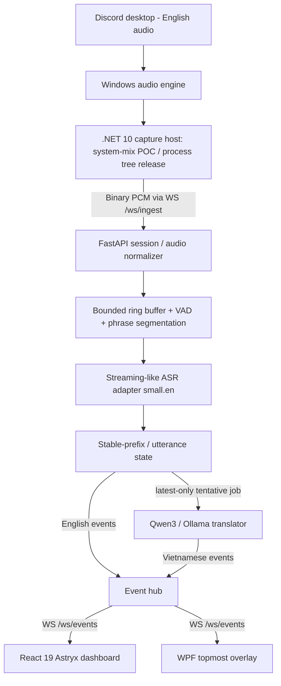

# Runtime architecture / boundaries

## Explicit process boundaries
- `AudioHost.exe` owns Windows capture; no ML libraries. It sends `audio.format` JSON once and binary PCM frames; audio capture thread never waits on AI.
- `FastAPI` owns inference state, utterance lifecycle, bounded queues, backend selection, metrics and local event hub.
- `apps/web` owns theme, layout, user controls, latency graphs/history. It is NOT authorized to capture Discord application audio directly.
- `Overlay.exe` reads event stream, displays last Vietnamese caption; it MUST NOT independently load ML models.

## Network/control plane
- Backend: `127.0.0.1:8765` (`/health`, `/api/status`, `/api/control`, `/ws/ingest`, `/ws/events`).
- Web UI dev: `127.0.0.1:5173`; production build served through a local host in later milestone.
- Ollama: `127.0.0.1:11434`, used only when explicitly enabled; no off-machine access.
- A single ingest session at a time; concurrent UIs may subscribe. Reject or replace producer based on visible policy (M2) to avoid audio duplication.

## Sequence
1. UI connects and fetches status. `capture=inactive` until host is actually connected.
2. Audio host connects to `/ws/ingest`, sends format `{sample_rate,channels,sample_format}` and binary frames. Current PoC is **system loopback**, not Discord-only.
3. Backend validates format, normalizes PCM to float32 mono 16 kHz (streaming resampler refinement required), enqueues into bounded recent-audio window. No persistent audio writes.
4. VAD partitions active audio; ASR sees rolling crops with overlap. ASR emits tentative text, later final utterance.
5. Translation consumes stable clauses / final utterance with revision IDs; superseded tentative job results must not overwrite newer text.
6. Event bus fans out to web and WPF, clients discard out-of-order revisions.
7. Metrics record capture, ASR, translation timings and event age; transcript export only with explicit user action.

## Typed event wire format (v1)
See `contracts/events.schema.json` and `docs/11-CONTRACTS.md`. All times are monotonic for latency analytics when possible; `created_at_ms` is wall clock UTC for display only. Do NOT subtract monotonic clocks across processes unless an offset calibration exists. On one process, use `perf_counter` for ASR queue waits; for end-to-end latency use audio sample index + anchor correlation and carefully defined uncertainty.

## Known anti-patterns
- Calling Whisper in the WASAPI DataAvailable callback.
- Capturing system output and claiming it is Discord-only.
- Feeding one ASR inference result for each 20ms chunk; rolling windows cause duplication.
- Translating every token, causing unstable Vietnamese sentence order.
- Infinite asyncio queue, unbounded latest-results list, GPU model loaded twice.
- Catch-all exception that silently replaces failed model with a fake translation.
- Storing every audio byte as a debugging convenience.

## Planned source-specific capture design
Microsoft process-specific loopback uses `ActivateAudioInterfaceAsync` with `AUDIOCLIENT_ACTIVATION_TYPE_PROCESS_LOOPBACK` and `AUDIOCLIENT_PROCESS_LOOPBACK_PARAMS` and `TargetProcessId`, modes `PROCESS_LOOPBACK_MODE_INCLUDE_TARGET_PROCESS_TREE`. Use official C++ sample to validate PID tree before porting to .NET. When Discord changes PID, the capture host must re-enumerate/reinitialize. `WasapiLoopbackCapture` in NAudio is a whole-output-endpoint capture, not equivalent.
